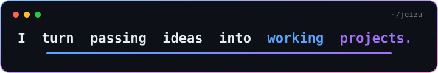

# Justine Rivera

IT student in the Philippines. I build web apps and follow ideas through to deployment.

[Projects](#projects) · [Stack](#stack) · [Contact](#contact)

 

## About

I care about software development and cybersecurity. I write code consistently and ship what I build.

## Projects

| Project | What it is | Built with | Links |
| :-- | :-- | :-- | :-- |
| **handa-ph** | Philippines typhoon and wind signal alerts PWA (unofficial PAGASA mirror) | TypeScript, PWA | [Demo](https://handa-ph-iota.vercel.app) · [Code](https://github.com/jeizu-ri/handa-ph) |
| **BudgetTracker** | Personal budget tracker | TypeScript | [Demo](https://budgettracker-snowy.vercel.app) · [Code](https://github.com/jeizu-ri/BudgetTracker) |
| **Daily Intentionality Scheduler** | iPad-first PWA that stacks intention blocks from a start time and exports the day to Calendar. No build step | JavaScript, IndexedDB | [Demo](https://daily-intentionality-scheduler-six.vercel.app) · [Code](https://github.com/jeizu-ri/daily-intentionality-scheduler) |
| **Testris** | Two-player Tetris battle against a bot, playable in the browser | JavaScript | [Demo](https://tetro-flow.vercel.app) · [Code](https://github.com/jeizu-ri/tetro-flow) |
| **BrightSmile** | Team project I co-developed with Kaizweeen | TypeScript | [Demo](https://brightsmile.pro) · [Code](https://github.com/Kaizweeen/BrightSmile) |
| **OrgManager** | Organization management app, co-developed with Kekmw | PHP | [Code](https://github.com/Kekmw/OrgManager) |

More on my [repositories](https://github.com/jeizu-ri?tab=repositories) page.

## Stack

**Languages**  

**Frameworks**  

**Data**  

**Tools**  

**AI tools**  

**Learning:** TypeScript, SQL

## Contact

Open to internship opportunities. The best way to reach me is email: [justinerivera.tech@gmail.com](mailto:justinerivera.tech@gmail.com)
